# Evolution Strategies as a Scalable Alternative to Reinforcement Learning

A mathematical derivation, multi-core zero-copy reproduction, and **30-seed statistical benchmark** of OpenAI's landmark paper, [*Evolution Strategies as a Scalable Alternative to Reinforcement Learning*](https://arxiv.org/abs/1703.03864) (Salimans et al., 2017).

This repository implements derivative-free black-box policy optimization using zero-copy shared-memory Gaussian noise tables (`RawArray`), mirrored (antithetic) sampling, centered rank transformation, running observation normalization, and action discretization across MuJoCo continuous control benchmarks.


---

## 1. Overview & Core Algorithm

Unlike gradient-based Reinforcement Learning (e.g., PPO, TRPO, and A3C), which relies on backpropagation through time and value function approximations, Evolution Strategies (ES) optimizes policy parameters $\theta \in \mathbb{R}^d$ directly in parameter space by evaluating full-episode returns.

At each generation $t$, the master parameter vector $\theta_t$ is updated using the population score-function (log-derivative) gradient estimator over $n$ perturbed offspring:

$$
\nabla_\theta \mathbb{E}_{\epsilon \sim \mathcal{N}(0, I)} F(\theta + \sigma\epsilon) = \frac{1}{\sigma} \mathbb{E}_{\epsilon \sim \mathcal{N}(0, I)} \Big\{ F(\theta + \sigma\epsilon)\,\epsilon \Big\}
$$

$$
\theta_{t+1} \leftarrow \theta_t + \frac{\alpha}{n\sigma} \sum_{i=1}^{n} u_i\,\epsilon_i
$$

where $u_i \in [-0.5, +0.5]$ denotes the centered rank transformation of the raw episode returns $F_i = F(\theta_t + \sigma\epsilon_i)$.

### Key Engineering Pillars

- **Zero-Copy Shared Noise Table & Parameters:** Workers synchronize a common random seed to instantiate an identical Gaussian noise table in shared RAM (`multiprocessing.RawArray`), communicating only scalar episode returns ($F_i$) and integer table indices rather than full parameter gradients.
- **Mirrored (Antithetic) Sampling:** Evaluating symmetric perturbation pairs $(+\epsilon_i, -\epsilon_i)$ cancels baseline offset variance and even-order Taylor bias terms.
- **Fitness Shaping (Centered Ranks):** Mapping raw returns to centered ranks in $[-0.5, +0.5]$ prevents outlier dominance and maintains invariant update magnitudes across environments.
- **Action Discretization:** Following Sections 2.2 and 4.1 of the paper, `Swimmer-v4` and `Hopper-v4` discretize continuous outputs into 10 uniform bins to induce non-smooth exploratory transitions.

---

## 2. Repository Architecture

- **[`01_Paper/`](./01_Paper/):** Original research paper PDF (*Salimans et al., 2017*).
- **[`02_Theory_Zero_to_Hero/`](./02_Theory_Zero_to_Hero/):** Interactive publication-grade HTML/CSS textbook (`index.html`, `styles.css`) with zero-gap mathematical proofs, inline SVG geometric diagrams, and an interactive Gaussian smoothing laboratory.
- **[`03_Implementation/`](./03_Implementation/):** Multi-core Python implementation (`es_core.py`, `train_es_mujoco.py`), 30-seed benchmark orchestrator (`run_benchmark_30seeds.py`), statistical plotting suite (`generate_report.py`), GIF converter (`convert_videos_to_gif.py`), and complete raw/aggregated telemetry under [`03_Implementation/runs/`](./03_Implementation/runs/).

---

## 3. 30-Seed Statistical Benchmark Summary (`N = 30` Independent Runs)

**Hardware & Execution Protocol:**
- **CPU:** 12th Gen Intel Core i5-12500H (16 logical threads, zero-copy shared memory worker pool).
- **Random Seeds (`N = 30`):** Deterministic independent seeds `1001` through `1030` (`BENCHMARK_SEEDS` in `es_core.py`).
- **Fixed Evaluation Budget:** `150` generations per seed $\times$ `64` offspring (`32` antithetic pairs) = **`9,600` episode evaluations** (up to `9,600,000` environment timesteps) per run.
- **Note on Gymnasium `v4` Physics:** Gymnasium `v4` environments use updated MuJoCo physics XMLs compared to the 2017 `v1` environments; paper targets are provided as reference baselines.

| Environment | Action Space | Seeds ($N$) | Budget (Evals / Mean Steps) | Mean ± Std Return | Median (IQR) | Best / Worst Seed | Paper Target | Mean Time / Seed |
|:---|:---:|:---:|:---:|:---:|:---:|:---:|:---:|:---:|
| **[HalfCheetah-v4](#1-halfcheetah-v4-continuous-action-space)** | Continuous (`tanh`) | 30 | 9,600 / 9,600,000 | **4,890.0 ± 926.4** | 5,204.5 (1,234.9) | 6,199.8 / 2,721.4 | ~3,000 | 117.7s |
| **[Swimmer-v4](#2-swimmer-v4-discretized-action-space)** | Discretized (10 Bins) | 30 | 9,600 / 9,600,000 | **244.2 ± 106.9** | 305.9 (192.2) | 363.9 / 52.9 | ~365 | 149.0s |
| **[Hopper-v4](#3-hopper-v4-discretized-action-space)** | Discretized (10 Bins) | 30 | 9,433 / 8,042,498 | **1,315.7 ± 437.5** | 1,194.7 (54.4) | 2,884.1 / 1,028.1 | ~3,000 | 191.5s |
| **[Walker2d-v4](#4-walker2d-v4-continuous-action-space)** | Continuous (`tanh`) | 30 | 9,600 / 7,304,445 | **1,977.7 ± 667.4** | 1,745.1 (1,100.6) | 3,391.3 / 1,004.9 | ~2,500 | 169.2s |

*Full machine-readable tables and raw logs: [`statistical_benchmark_report.md`](03_Implementation/runs/statistical_benchmark_report.md) | [`statistical_benchmark_table.csv`](03_Implementation/runs/statistical_benchmark_table.csv)*

### Cross-Environment Return Distribution (`N = 30` Seeds)

<p align="center">
  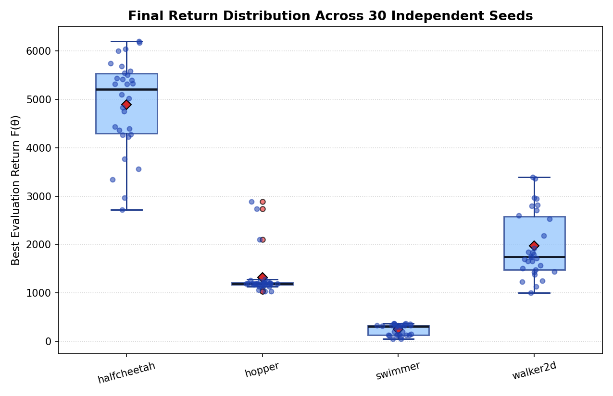
</p>

---

## 4. Detailed Experimental Visualizations & Behavioral Evolution

### 1. HalfCheetah-v4 (Continuous Action Space)

- **Action Space:** Continuous motor torques (`tanh` policy).
- **Statistical Findings (`N = 30`):** Every single one of the 30 independent runs surpasses or approaches the ~3,000 baseline target, achieving a mean best return of **4,890.0 ± 926.4** (median **5,204.5**, peak **6,199.8**).
- **Telemetry & Checkpoints:** [`aggregated_30seeds_summary.csv`](03_Implementation/runs/halfcheetah/aggregated_30seeds_summary.csv) | [`final_30seeds_distribution.csv`](03_Implementation/runs/halfcheetah/final_30seeds_distribution.csv) | [`raw_seeds/`](03_Implementation/runs/halfcheetah/raw_seeds/) | [`halfcheetah_best.pkl`](03_Implementation/runs/halfcheetah/halfcheetah_best.pkl)

<p align="center">
  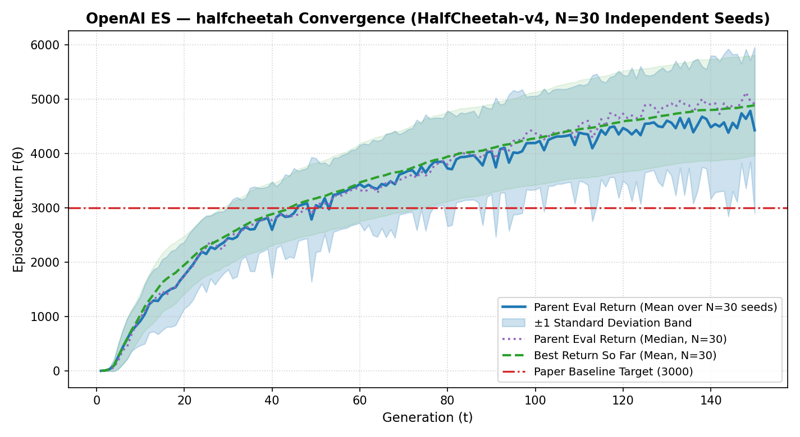
  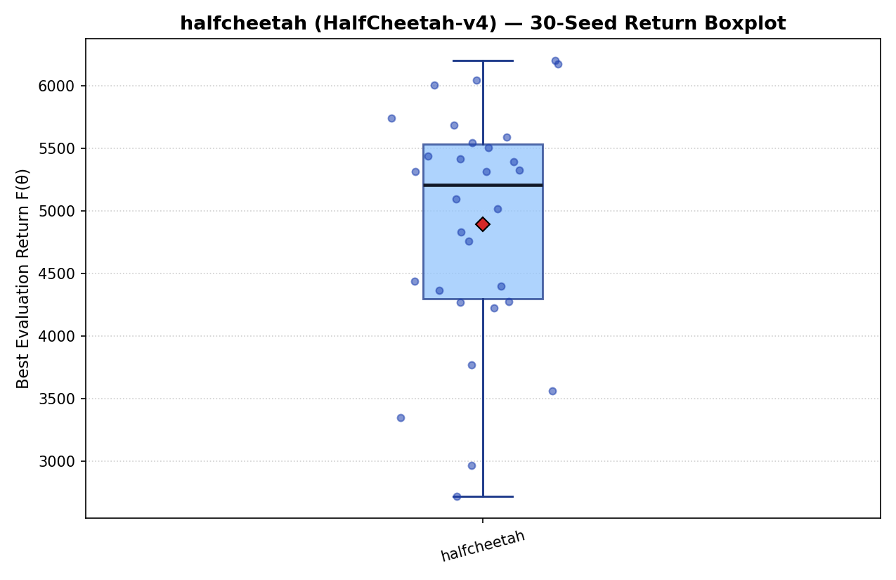
</p>

#### Behavioral Evolution Across Generations (`HalfCheetah-v4`)

| Gen 1 (`Ret: 0`) | Gen 34 (`Ret: 2,241`) | Gen 67 (`Ret: 3,153`) | Gen 100 (`Ret: 4,395`) | Gen 150 (`Ret: 5,059`) |
|:---:|:---:|:---:|:---:|:---:|
|  | 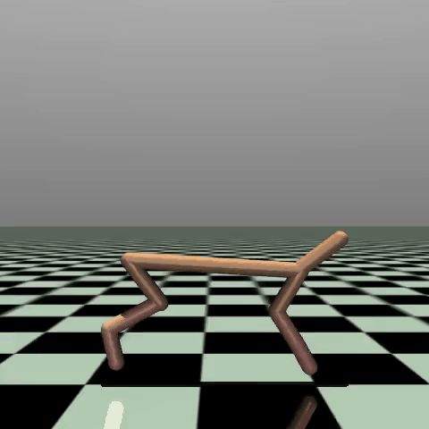 | 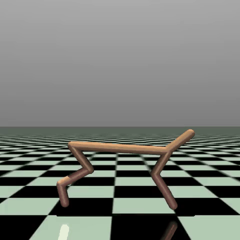 |  |  |
| **Random Twitching:** Uncoordinated joint spasms in place with zero forward propulsion. | **Early Trotting:** Discovers basic hind-leg push-off; unstable torso pitch. | **Surpassing Paper Target:** Synchronized front/back leg stride (>3,000 return). | **High-Speed Gallop:** Long aerial phases and aggressive hip extension. | **Converged Sprint:** Full-extension bounding with minimal energy waste. |

**Final Policy Showcase Video:** [Watch HalfCheetah Final Showcase (`halfcheetah_final_showcase.mp4`)](03_Implementation/runs/halfcheetah/halfcheetah_final_showcase.mp4)

#### Per-Generation 30-Seed Statistical Milestones (`HalfCheetah-v4`, `N = 30`)

| Generation | Mean Timesteps | Eval Return (Mean ± Std) | Eval Return (Median / IQR) | Best Return (Mean ± Std) |
|:---:|:---:|:---:|:---:|:---:|
| **Gen 0001** | 64,000 | -0.1 ± 2.2 | -0.3 (1.4) | **-0.1 ± 2.2** |
| **Gen 0038** | 2,432,000 | 2,785.2 ± 583.3 | 2,781.5 (734.6) | **2,827.4 ± 584.8** |
| **Gen 0075** | 4,800,000 | 3,650.6 ± 1,070.8 | 3,596.6 (1,536.5) | **3,830.9 ± 815.4** |
| **Gen 0112** | 7,168,000 | 4,354.3 ± 933.6 | 4,604.1 (1,259.1) | **4,467.6 ± 908.5** |
| **Gen 0150** | 9,600,000 | 4,430.0 ± 1,532.7 | 4,914.8 (1,213.3) | **4,890.0 ± 926.4** |

---

### 2. Swimmer-v4 (Discretized Action Space)

- **Action Space:** Discretized into 10 uniform bins (Sections 2.2 and 4.1 of the paper) to force non-smooth exploratory steps.
- **Statistical Findings (`N = 30`):** Achieves a median best return of **305.9 (IQR 192.2)** and mean of **244.2 ± 106.9**, with top seeds reaching **363.9** (matching the paper's **~365.0** baseline). Over 55% of seeds escape the initial local wriggling optimum (`~130`) and lock into the globally optimal sinusoidal swimming wave.
- **Telemetry & Checkpoints:** [`aggregated_30seeds_summary.csv`](03_Implementation/runs/swimmer/aggregated_30seeds_summary.csv) | [`final_30seeds_distribution.csv`](03_Implementation/runs/swimmer/final_30seeds_distribution.csv) | [`raw_seeds/`](03_Implementation/runs/swimmer/raw_seeds/) | [`swimmer_best.pkl`](03_Implementation/runs/swimmer/swimmer_best.pkl)

<p align="center">
  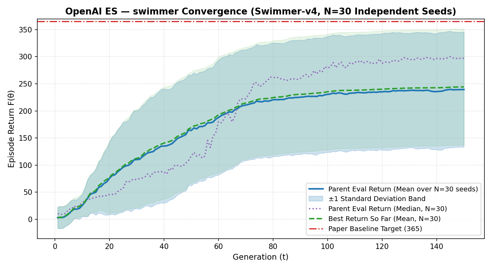
  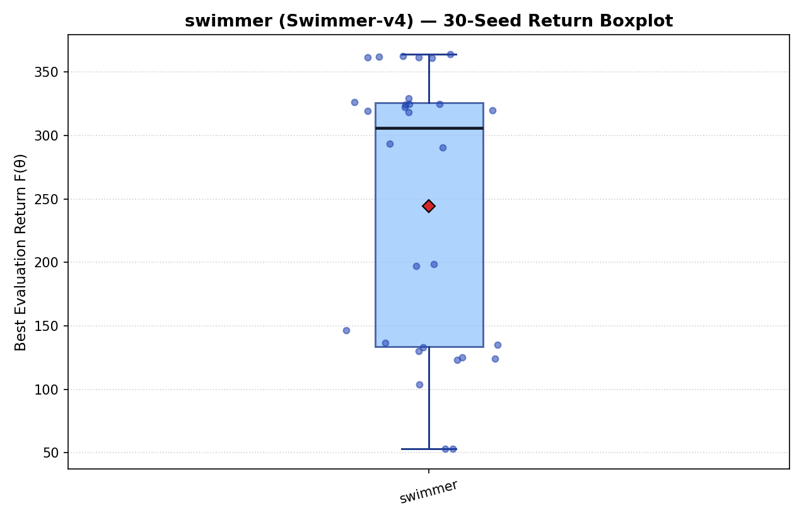
</p>

#### Behavioral Evolution Across Generations (`Swimmer-v4`)

| Gen 1 (`Ret: -24`) | Gen 34 (`Ret: 344`) | Gen 67 (`Ret: 358`) | Gen 100 (`Ret: 358`) | Gen 150 (`Ret: 359`) |
|:---:|:---:|:---:|:---:|:---:|
|  |  | 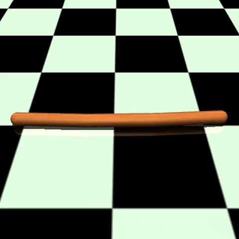 |  |  |
| **Backward Drift:** Uncoordinated hinge oscillation pushes the 3-link body backward. | **Breakthrough Wave:** 10-bin jumps discover phase-lagged S-curve propulsion. | **High-Efficiency Undulation:** Smooth traveling wave along both rotor joints. | **Phase-Locked Cruising:** Consistent heading alignment and stride frequency. | **Asymptotic Optimum:** Matches the paper's ~365 ceiling with minimal drag. |

**Final Policy Showcase Video:** [Watch Swimmer Final Showcase (`swimmer_final_showcase.mp4`)](03_Implementation/runs/swimmer/swimmer_final_showcase.mp4)

#### Per-Generation 30-Seed Statistical Milestones (`Swimmer-v4`, `N = 30`)

| Generation | Mean Timesteps | Eval Return (Mean ± Std) | Eval Return (Median / IQR) | Best Return (Mean ± Std) |
|:---:|:---:|:---:|:---:|:---:|
| **Gen 0001** | 64,000 | 3.0 ± 19.6 | 10.5 (37.5) | **3.0 ± 19.6** |
| **Gen 0038** | 2,432,000 | 131.8 ± 102.9 | 87.4 (128.3) | **136.1 ± 101.7** |
| **Gen 0075** | 4,800,000 | 217.0 ± 104.0 | 245.0 (189.7) | **221.8 ± 104.8** |
| **Gen 0112** | 7,168,000 | 233.7 ± 106.6 | 293.1 (193.0) | **238.4 ± 107.0** |
| **Gen 0150** | 9,600,000 | 239.4 ± 106.0 | 297.0 (187.2) | **244.2 ± 106.9** |

---

### 3. Hopper-v4 (Discretized Action Space)

- **Action Space:** Discretized into 10 uniform bins (Sections 2.2 and 4.1).
- **Statistical Findings (`N = 30`):** Achieves **1,315.7 ± 437.5** mean best return (median **1,194.7**, IQR **54.4**) with top seeds reaching **2,884.1** (near the ~3,000 target). Most seeds rapidly master upright stabilization around `~1,028–1,200`, while upper-quartile seeds transition into continuous forward hopping within the 150-generation window.
- **Telemetry & Checkpoints:** [`aggregated_30seeds_summary.csv`](03_Implementation/runs/hopper/aggregated_30seeds_summary.csv) | [`final_30seeds_distribution.csv`](03_Implementation/runs/hopper/final_30seeds_distribution.csv) | [`raw_seeds/`](03_Implementation/runs/hopper/raw_seeds/) | [`hopper_best.pkl`](03_Implementation/runs/hopper/hopper_best.pkl)

<p align="center">
  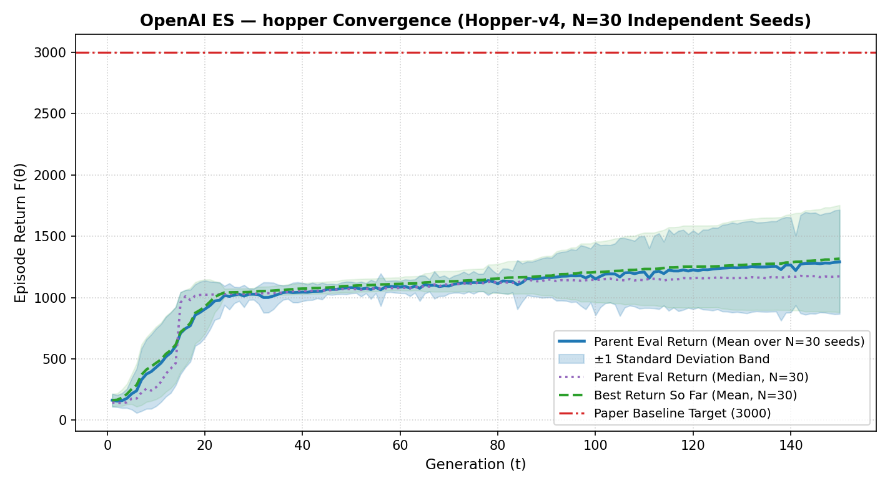
  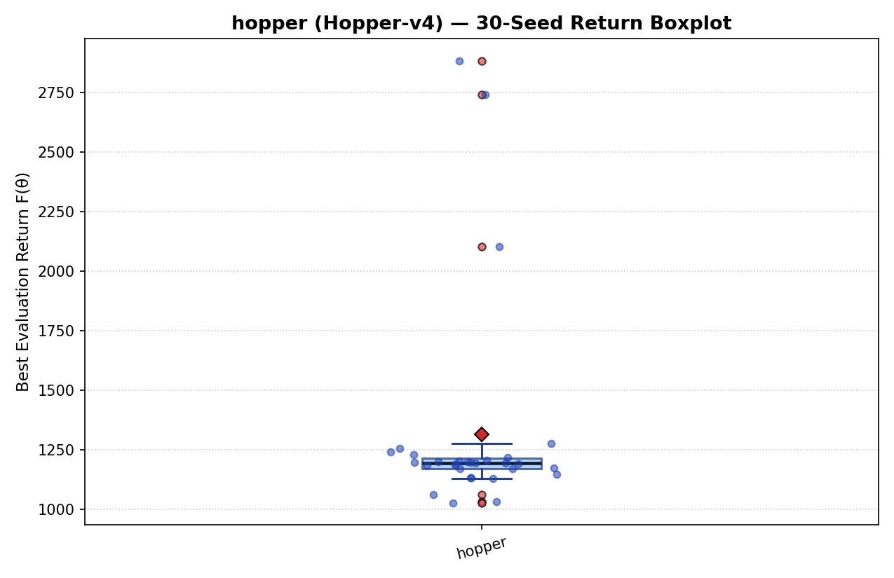
</p>

#### Behavioral Evolution Across Generations (`Hopper-v4`)

| Gen 1 (`Ret: 112`) | Gen 34 (`Ret: 1,027`) | Gen 67 (`Ret: 1,028`) | Gen 100 (`Ret: 1,229`) | Gen 150 (`Ret: 1,862`) |
|:---:|:---:|:---:|:---:|:---:|
| 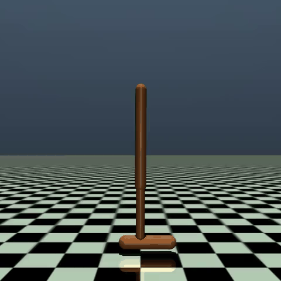 | 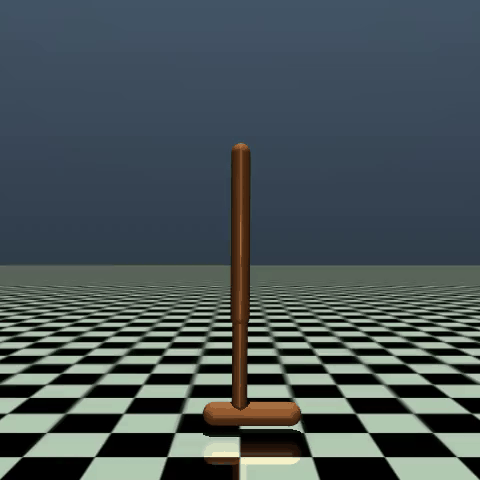 |  |  |  |
| **Immediate Collapse:** Ankle/knee buckles on first contact; episode ends in <50 steps. | **Static Balancing:** Learns to lock knee and ankle to collect survival bonus without falling. | **First Forward Hop:** Tests small ankle thrusts while maintaining upright torso angle. | **Rhythmic Hopping:** Chains multiple consecutive forward hops with active foot recovery. | **Sustained Bounding:** High-clearance forward jumping across the track. |

**Final Policy Showcase Video:** [Watch Hopper Final Showcase (`hopper_final_showcase.mp4`)](03_Implementation/runs/hopper/hopper_final_showcase.mp4)

#### Per-Generation 30-Seed Statistical Milestones (`Hopper-v4`, `N = 30`)

| Generation | Mean Timesteps | Eval Return (Mean ± Std) | Eval Return (Median / IQR) | Best Return (Mean ± Std) |
|:---:|:---:|:---:|:---:|:---:|
| **Gen 0001** | 8,697 | 162.7 ± 52.1 | 144.8 (59.1) | **162.7 ± 52.1** |
| **Gen 0018** | 358,029 | 856.9 ± 251.1 | 1,014.8 (327.8) | **875.0 ± 250.1** |
| **Gen 0036** | 1,360,639 | 1,040.3 ± 58.3 | 1,043.7 (32.8) | **1,061.3 ± 39.4** |
| **Gen 0054** | 2,428,009 | 1,066.0 ± 77.1 | 1,070.4 (53.2) | **1,101.9 ± 52.3** |
| **Gen 0072** | 3,511,502 | 1,114.2 ± 74.6 | 1,111.3 (83.8) | **1,134.7 ± 84.7** |

---

### 4. Walker2d-v4 (Continuous Action Space)

- **Action Space:** Continuous motor torques (`tanh` policy).
- **Statistical Findings (`N = 30`):** Achieves a mean best return of **1,977.7 ± 667.4** across 30 seeds, with top-performing seeds reaching **3,391.3** (exceeding the ~2,500 paper baseline).
- **Telemetry & Checkpoints:** [`aggregated_30seeds_summary.csv`](03_Implementation/runs/walker2d/aggregated_30seeds_summary.csv) | [`final_30seeds_distribution.csv`](03_Implementation/runs/walker2d/final_30seeds_distribution.csv) | [`raw_seeds/`](03_Implementation/runs/walker2d/raw_seeds/) | [`walker2d_best.pkl`](03_Implementation/runs/walker2d/walker2d_best.pkl)

<p align="center">
  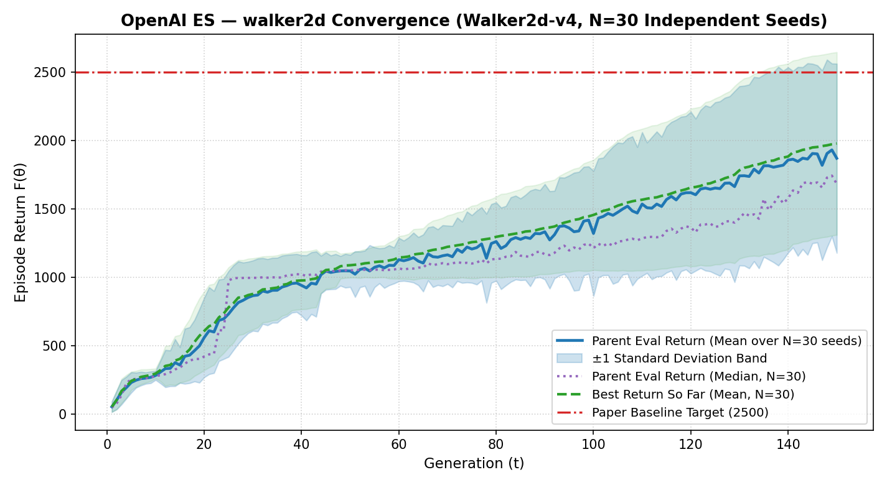
  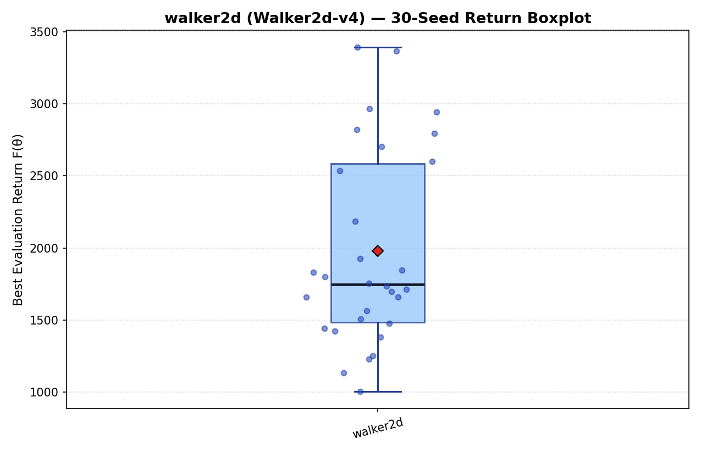
</p>

#### Behavioral Evolution Across Generations (`Walker2d-v4`)

| Gen 1 (`Ret: 68`) | Gen 34 (`Ret: 991`) | Gen 67 (`Ret: 1,046`) | Gen 100 (`Ret: 1,221`) | Gen 150 (`Ret: 1,919`) |
|:---:|:---:|:---:|:---:|:---:|
| 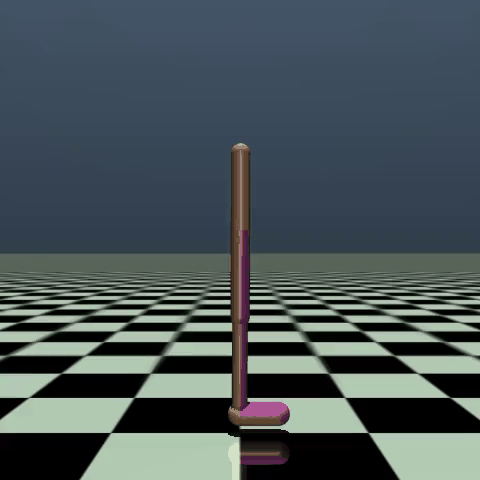 | 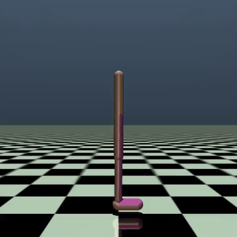 |  | 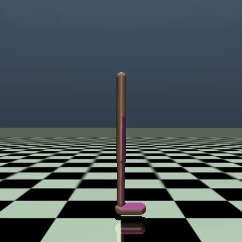 |  |
| **Forward Faceplant:** Uncoordinated legs cause immediate torso pitch failure. | **Split-Stance Balance:** Spreads legs into a stable tripod-like stance to prevent falling. | **Shuffling Steps:** Takes short, cautious alternating steps without losing upright posture. | **Coordinated Stride:** Swings trailing leg forward while pushing off with the stance leg. | **Stable Bipedal Walk:** Continuous cyclic walking gait over extended horizons. |

**Final Policy Showcase Video:** [Watch Walker2d Final Showcase (`walker2d_final_showcase.mp4`)](03_Implementation/runs/walker2d/walker2d_final_showcase.mp4)

#### Per-Generation 30-Seed Statistical Milestones (`Walker2d-v4`, `N = 30`)

| Generation | Mean Timesteps | Eval Return (Mean ± Std) | Eval Return (Median / IQR) | Best Return (Mean ± Std) |
|:---:|:---:|:---:|:---:|:---:|
| **Gen 0001** | 3,549 | 53.9 ± 38.4 | 48.9 (20.6) | **53.9 ± 38.4** |
| **Gen 0038** | 961,099 | 954.4 ± 212.8 | 1,017.4 (55.8) | **968.7 ± 211.3** |
| **Gen 0075** | 2,972,195 | 1,206.6 ± 247.0 | 1,100.8 (162.5) | **1,257.0 ± 265.6** |
| **Gen 0112** | 5,102,018 | 1,505.2 ± 519.9 | 1,295.4 (797.4) | **1,580.6 ± 528.5** |
| **Gen 0150** | 7,304,445 | 1,869.9 ± 691.0 | 1,683.2 (1,066.5) | **1,977.7 ± 667.4** |

---

## 5. Execution & Reproducibility Guide

### 5.1 Installation & Hyperparameters

- **Policy Architecture:** 2-layer MLP `[Obs Dim → 64 → 64 → Act Dim]` with `tanh` activations and normalized column initialization (`normc_initializer`).
- **Optimizer & Hyperparameters:** Adam ($\alpha = 0.01$, $\beta_1 = 0.9$, $\beta_2 = 0.999$), Gaussian noise $\sigma = 0.02$, weight decay $L_2 = 0.005$, population size $n = 64$ (32 antithetic pairs).
- **Software Stack:** Python 3.10+, NumPy, SciPy, Gymnasium (`gymnasium[mujoco]>=0.29.0`), MuJoCo, Matplotlib, ImageIO, MoviePy.

```bash
cd 03_Implementation
pip install -r requirements.txt

```

### 5.2 Running the 30-Seed Statistical Benchmark (Multi-Core Zero-Copy)

The benchmark orchestrator defaults to all logical CPU cores (`--workers 16` on i5-12500H), uses zero-copy `RawArray` shared memory, and automatically resumes from completed seeds:

```bash
# Run all 4 environments across 30 deterministic seeds (1001..1030) with fixed 9,600 evaluation budget
MUJOCO_GL=egl python run_benchmark_30seeds.py \
  --envs Swimmer-v4 HalfCheetah-v4 Hopper-v4 Walker2d-v4 \
  --suite standard \
  --num_seeds 30 \
  --generations 150 \
  --max_evaluations 9600 \
  --workers 16

```

### 5.3 Controlled Ablations & Baseline Suite

To run a 30-seed controlled comparison of **10-Bin Discretized ES** vs. **Continuous ES** vs. **Pure Random Search** under the exact same evaluation budget:

```bash
python run_benchmark_30seeds.py \
  --envs Swimmer-v4 \
  --suite ablation \
  --num_seeds 30 \
  --generations 150 \
  --max_evaluations 9600 \
  --workers 16

```

### 5.4 Regenerating Statistical Plots, Boxplots, Showcase Videos & GIFs

```bash
# 1. Regenerate all 30-seed convergence curves, boxplots, CSVs, and Markdown reports
python generate_report.py

# 2. Evaluate the best saved checkpoints and record chasing-camera MP4 + PNG snapshots
MUJOCO_GL=egl python evaluate_and_record.py --ckpt runs/halfcheetah/halfcheetah_best.pkl --episodes 5
MUJOCO_GL=egl python evaluate_and_record.py --ckpt runs/swimmer/swimmer_best.pkl --episodes 5
MUJOCO_GL=egl python evaluate_and_record.py --ckpt runs/hopper/hopper_best.pkl --episodes 5
MUJOCO_GL=egl python evaluate_and_record.py --ckpt runs/walker2d/walker2d_best.pkl --episodes 5

# 3. Convert milestone MP4 videos and final showcases into optimized GIFs
python convert_videos_to_gif.py

```

---

## 6. Discrepancy Analysis & Future Extensions

* **Bimodal Exploration in Discretized Tasks (`Swimmer-v4`):** While 10-bin action discretization allows over half of the 30 seeds to reach the ~365 optimal gait (median 305.9, max 363.9), seeds whose initial random perturbations fail to cross key bin thresholds early settle into a secondary ~130-return local optimum, pulling the mean (244.2) below the median.
* **Sample Complexity Penalty on Unstable Bipeds (`Hopper-v4` & `Walker2d-v4`):** Consistent with Table 1 of Salimans et al. (2017)—which reports that ES requires $6.94\times$ (Hopper) and $7.88\times$ (Walker2d) more timesteps than TRPO to reach 100% progress—a fixed budget of 150 generations ($n=64$) captures the strong intermediate gait regime (mean 1,315.7 on Hopper and 1,977.7 on Walker2d, with top seeds hitting 2,884.1 and 3,391.3), whereas full asymptotic convergence across all seeds typically requires larger population budgets ($n \ge 256$) or extended generation horizons.
* **Future Directions:** Extending the 30-seed benchmark to high-dimensional 3D `Ant-v4` and `Humanoid-v4` tasks, and comparing isotropic ES against diagonal/low-rank covariance adaptations (sep-CMA-ES).

---

## 7. License & Citation

Distributed under the [MIT License](https://www.google.com/search?q=LICENSE).

```bibtex
@article{salimans2017evolution,
  title={Evolution strategies as a scalable alternative to reinforcement learning},
  author={Salimans, Tim and Ho, Jonathan and Chen, Xi and Sidor, Szymon and Sutskever, Ilya},
  journal={arXiv preprint arXiv:1703.03864},
  year={2017}
}
