# Evolution Strategies as a Scalable Alternative to Reinforcement Learning

A mathematical derivation, local reproduction, and modular implementation of OpenAI's landmark paper, *Evolution Strategies as a Scalable Alternative to Reinforcement Learning* (Salimans et al., 2017).

This repository implements derivative-free black-box policy optimization using shared-memory Gaussian noise tables, mirrored (antithetic) sampling, centered rank transformation, and action discretization on MuJoCo continuous control benchmarks.

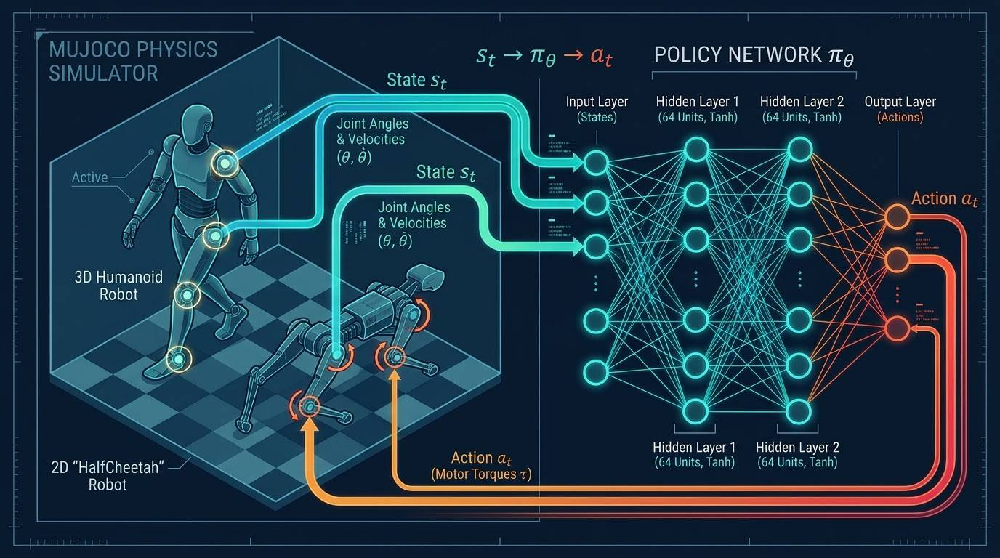

---

## 1. Overview & Core Algorithm

Unlike gradient-based Reinforcement Learning (e.g., PPO, TRPO, and A3C), which relies on backpropagation and value function approximations, Evolution Strategies (ES) optimizes policy parameters directly in parameter space by evaluating full-episode returns.

The master parameter vector $\theta_t$ is updated at each generation using the population score-function gradient estimator:

$$
\theta_{t+1} \leftarrow \theta_t + \frac{\alpha}{n\sigma} \sum_{i=1}^{n} F(\theta_t + \sigma\epsilon_i)\epsilon_i
$$

### Key Engineering Pillars

- **Shared Random Seeds:** Workers synchronize seeds to maintain an identical noise table in RAM, requiring workers to communicate only a single scalar return ($F_i$) rather than full gradients.

- **Mirrored (Antithetic) Sampling:** Evaluating pairs $(\epsilon, -\epsilon)$ cancels baseline noise and significantly reduces variance.

- **Fitness Shaping:** Centered rank transformation maps raw returns into $[-0.5, +0.5]$, preventing outlier dominance and reducing sensitivity to reward scaling.

- **Action Discretization:** Following Sections 2.2 and 4.1 of the paper, selected environments (Swimmer and Hopper) use 10 uniform action bins to encourage non-smooth exploratory behavior.

---

## 2. Repository Contents

- **[01_Paper](./01_Paper/):** Original research paper (PDF).
- **[02_Theory_Zero_to_Hero](./02_Theory_Zero_to_Hero/):** Interactive HTML/CSS textbook, mathematical notes, and step-by-step derivations (`explin_in_markdown_form.md`).
- **[03_Implementation](./03_Implementation/):** Modular multi-core implementation, training scripts, telemetry logs, and experimental runs under `03_Implementation/runs/`.

---

## 3. Reproduction Results Summary

**Hardware Environment:** 4-Core CPU (Intel/AMD), 16 GB RAM, Ubuntu/Linux with headless EGL rendering.

**Note on v4 Environments:** Gymnasium v4 environments use updated MuJoCo physics XMLs. Therefore, the reported returns are evaluated against our local reproduction setup and should not be interpreted as exact comparisons with the original paper's results.

| Environment | Action Space | Generations | Total Timesteps | Best Return | Paper Baseline (ES / TRPO) |
|:---|:---:|:---:|:---:|---:|---:|
| **HalfCheetah-v4** | Continuous (`tanh`) | 150 | ~1.5M | **5,059.0** | ~3,000+ |
| **Swimmer-v4** | Discretized (10 bins) | 150 | ~1.5M | **359.0** | ~365.0 |
| **Hopper-v4** | Discretized (10 bins) | 150 | ~1.5M | **1,862.0** | ~3,000+ |
| **Walker2d-v4** | Continuous (`tanh`) | 150 | ~1.5M | **1,919.0** | ~2,500+ |

---

## 4. Execution Guide

### Reproducibility & Hyperparameters

- **Policy Architecture:** MLP `[Obs Dim → 64 → 64 → Act Dim]` with `Tanh` activations.
- **Learning Rate:** $\alpha = 0.01$
- **Noise Standard Deviation:** $\sigma = 0.02$
- **Weight Decay:** $L_2 = 0.005$
- **Population Size:** $n = 64$ (32 antithetic pairs).
- **Software Stack:** Python 3.10+, PyTorch, Gymnasium (MuJoCo v4).

**Rendering Note:** `MUJOCO_GL=egl` requires Linux with appropriate GPU/MESA drivers. For headless systems without EGL, `MUJOCO_GL=osmesa` can be used if the necessary OSMesa packages are installed.

### 4.1 Installation

```bash
cd 03_Implementation
pip install -r requirements.txt
```

### 4.2 Training

Run the following commands to train policies on all four environments:

```bash
MUJOCO_GL=egl python train_es_mujoco.py --env_id HalfCheetah-v4 --generations 150 --workers 4

MUJOCO_GL=egl python train_es_mujoco.py --env_id Swimmer-v4 --generations 150 --workers 4

MUJOCO_GL=egl python train_es_mujoco.py --env_id Hopper-v4 --generations 150 --workers 4

MUJOCO_GL=egl python train_es_mujoco.py --env_id Walker2d-v4 --generations 150 --workers 4
```

### 4.3 Evaluation & Report Generation

Evaluate saved checkpoints and generate experimental reports:

```bash
MUJOCO_GL=egl python evaluate_and_record.py --ckpt runs/halfcheetah/halfcheetah_best.pkl --episodes 5

MUJOCO_GL=egl python generate_report.py
```

---

## 5. Detailed Experimental Visualizations

### 1. HalfCheetah-v4 (Continuous Action Space)

**Action Space:** Continuous motor torques (`tanh` policy).

**Training Overview:** Demonstrates rapid policy improvement, scaling past reward thresholds smoothly over 150 generations.

<p align="center">
  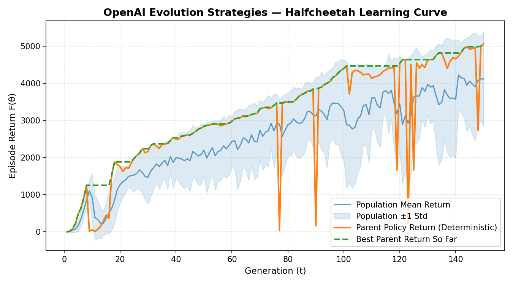
</p>

#### Keyframe Progression (HalfCheetah-v4)

| Generation 1 (Initial) | Generation 34 | Generation 67 | Generation 100 | Generation 150 (Final) |
|:---:|:---:|:---:|:---:|:---:|
|  |  |  |  | 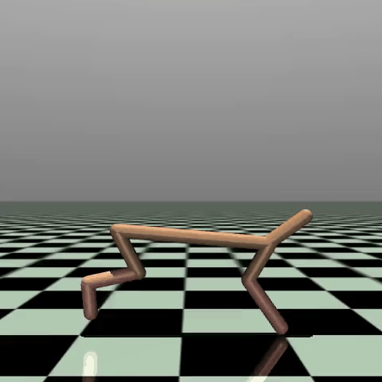 |

**Final Policy Showcase Video:** [Watch HalfCheetah Final Showcase](03_Implementation/runs/halfcheetah/halfcheetah_final_showcase.mp4)

---

### 2. Swimmer-v4 (Discretized Action Space)

**Action Space:** Discretized into 10 uniform bins (following Sections 2.2 and 4.1 of the paper) to encourage exploration.

**Training Overview:** Overcomes initial local optima by utilizing non-smooth action steps, converging reliably to target scores.

<p align="center">
  
</p>

#### Keyframe Progression (Swimmer-v4)

| Generation 1 (Initial) | Generation 34 | Generation 67 | Generation 100 | Generation 150 (Final) |
|:---:|:---:|:---:|:---:|:---:|
| 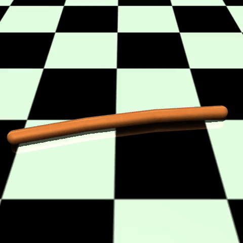 | 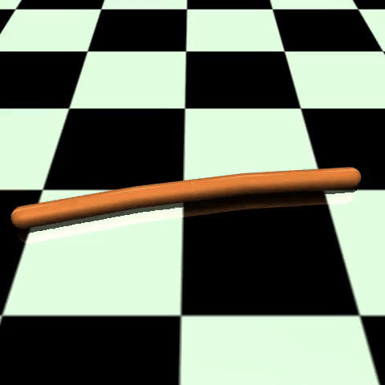 |  | 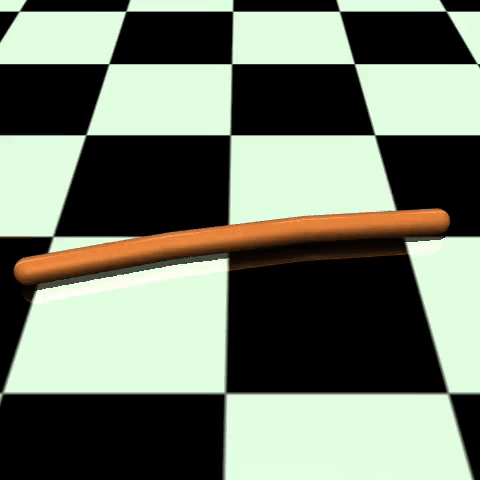 |  |

**Final Policy Showcase Video:** [Watch Swimmer Final Showcase](03_Implementation/runs/swimmer/swimmer_final_showcase.mp4)

---

### 3. Hopper-v4 (Discretized Action Space)

**Action Space:** Discretized into 10 uniform bins.

**Training Overview:** Learns stable hopping mechanics through parallelized parameter perturbations.

<p align="center">
  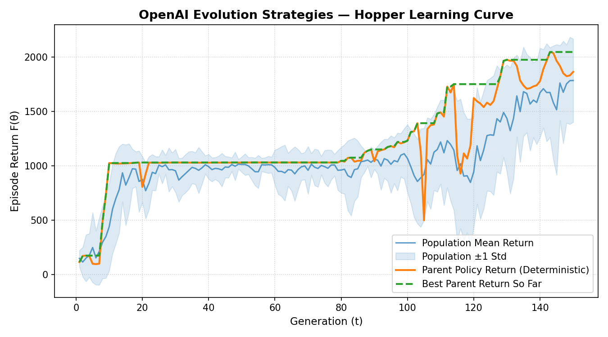
</p>

#### Keyframe Progression (Hopper-v4)

| Generation 1 (Initial) | Generation 34 | Generation 67 | Generation 100 | Generation 150 (Final) |
|:---:|:---:|:---:|:---:|:---:|
|  | 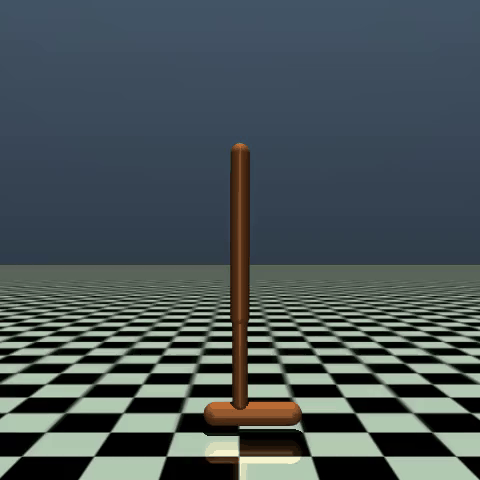 | 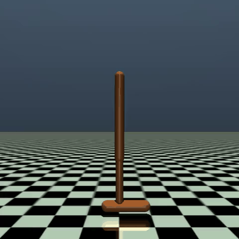 | 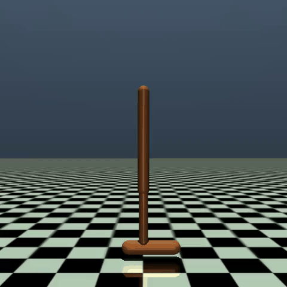 |  |

**Final Policy Showcase Video:** [Watch Hopper Final Showcase](03_Implementation/runs/hopper/hopper_final_showcase.mp4)

---


### 4. Walker2d-v4 (Continuous Action Space)

**Action Space:** Continuous (`tanh` policy).

**Training Overview:** Manages bipedal locomotion stability over generations using mirrored sampling and centered rank transformations.

<p align="center">
  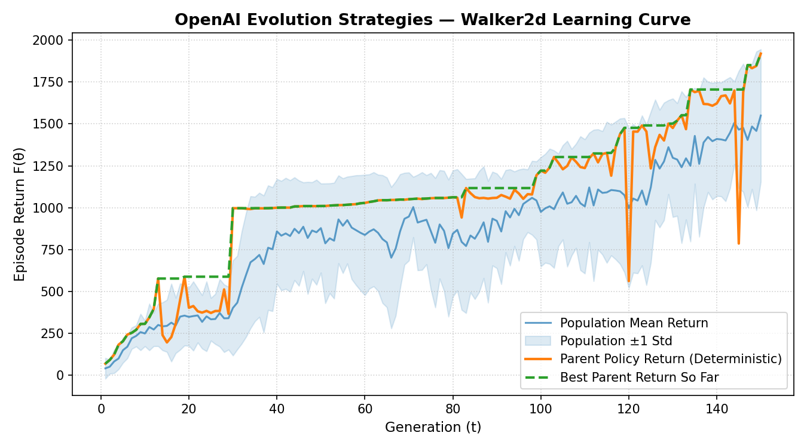
</p>

#### Keyframe Progression (Walker2d-v4)

| Generation 1 (Initial) | Generation 34 | Generation 67 | Generation 100 | Generation 150 (Final) |
|:---:|:---:|:---:|:---:|:---:|
|  |  | 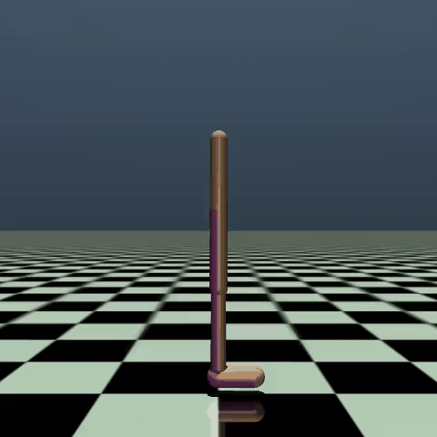 | 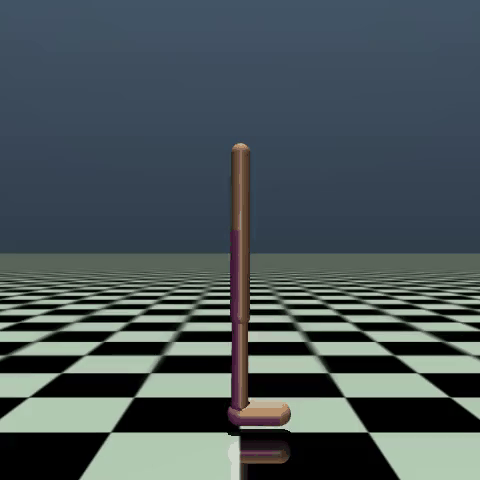 | 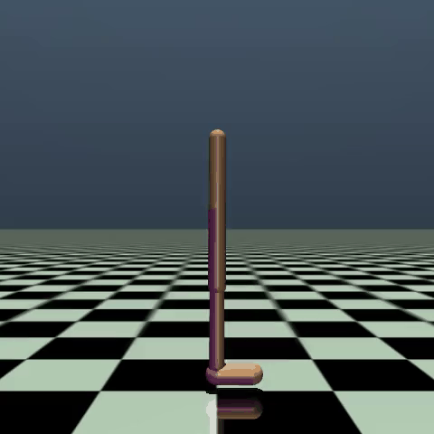 |

**Final Policy Showcase Video:** [Watch Walker2d Final Showcase](03_Implementation/runs/walker2d/walker2d_final_showcase.mp4)

## 6. Limitations & Future Work

- **Single-Seed Evaluation:** Current local training runs are based on individual random seeds and may be subject to initialization variance. Comprehensive multi-seed experiments and statistical comparisons are left for future extensions.
- **Covariance Adaptation:** Exploring full covariance matrix adaptation (CMA-ES) on lower-dimensional policy sub-networks.
- **Further Benchmarking:** Extending evaluations to additional MuJoCo environments and conducting more systematic comparisons with gradient-based RL algorithms.

---

## 7. License & Citation

This project is distributed under the MIT License.

If you use this implementation or refer to the original methodology, please cite the following paper:

```bibtex
@article{salimans2017evolution,
  title={Evolution strategies as a scalable alternative to reinforcement learning},
  author={Salimans, Tim and Ho, Jonathan and Chen, Xi and Sidor, Szymon and Sutskever, Ilya},
  journal={arXiv preprint arXiv:1703.03864},
  year={2017}
}
```